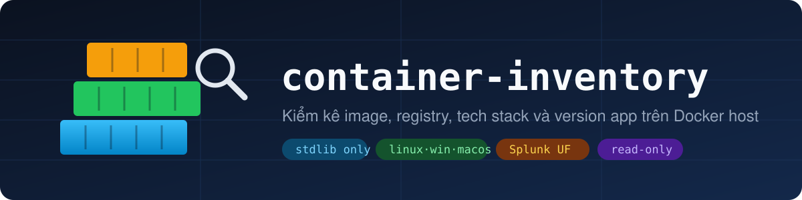

<p align="center">
  
</p>

<p align="center">
  <a href="https://github.com/namdodayne/container-inventory/actions/workflows/build.yml"></a>
  <a href="https://github.com/namdodayne/container-inventory/releases/latest"></a>
  
  
  
  
</p>

<p align="center">
  <b>Trên host này đang chạy gì, version nào, lấy từ đâu, container nào chưa được deploy lại?</b><br>
  Một file Python (hoặc một binary), không dependency, chỉ đọc. Kết quả đẩy thẳng vào Splunk.
</p>

---

## Tính năng

| | |
|---|---|
| 📦 **Nguồn gốc image** | registry, repo, tag, digest, chuỗi base image; nhận diện image **build local** (kể cả trên containerd store của Docker Desktop) |
| 🏷️ **Version app** | `kibana 9.3.8`, `cloudflared 2026.10.7`… lấy từ label OCI, tag semver hoặc Go build info, kèm `version_source` để biết độ tin cậy |
| 🧱 **Tech stack** | runtime + version (Node, Python, Java, Go, nginx, PostgreSQL, Redis…), framework và package (`--deep`), SQLite, ModSecurity/LuaJIT |
| 🔌 **Kết nối** | app nói chuyện với PostgreSQL / Redis / Mongo / HTTP nào, lấy từ env, **luôn bỏ user/password** |
| ⏳ **Container stale** | tag đã được build/pull lại nhưng container vẫn chạy image cũ |
| 🔗 **Git & app** | repo + commit từ label, mapping thủ công app / owner / env qua TOML |
| 🛡️ **An toàn** | mặc định chỉ đọc metadata của Docker; `--deep` chỉ chạy lệnh đọc (`cat`, `find`, `--version`) |

## Bắt đầu nhanh

**Binary** (không cần Python): tải từ [Releases](https://github.com/namdodayne/container-inventory/releases/latest).

| OS | File |
|---|---|
| Linux x86_64 / arm64 | `container-inventory-linux-amd64`, `-linux-arm64` (glibc ≥ 2.28: RHEL/Rocky 8+, Ubuntu 20.04+, Debian 10+) |
| Windows x64 | `container-inventory-windows-amd64.exe` |
| macOS Apple Silicon / Intel | `container-inventory-macos-arm64`, `-macos-amd64` |

```bash
chmod +x container-inventory-linux-amd64
./container-inventory-linux-amd64 -a            # bảng, gồm cả container đã dừng
./container-inventory-linux-amd64 -a --json     # bản ghi đầy đủ
./container-inventory-linux-amd64 -a --deep     # + framework, package, Go build info
```

**Python** (3.9+, chỉ stdlib):

```bash
./inventory.py -a
./inventory.py -a --deep --apps apps.toml --json > inventory.json
DOCKER_CONTEXT=prod-host ./inventory.py         # Docker remote
./inventory.py --selftest
```

User chạy tool phải gọi được Docker: thuộc group `docker`, dùng `sudo`, hoặc trỏ `DOCKER_HOST` tới một socket proxy chỉ đọc.

## Ví dụ đầu ra

```text
IMAGE                          REGISTRY  PRODUCT               TECH                          CONTAINERS
custom_waf26:latest            ghcr.io   bunkerweb v1.6.16     nginx 1.30.5, Python, Redis   team1_fuap_bunkerweb
louislam/uptime-kuma:2.5.6     docker.io uptime-kuma 2.5.6     Node.js 22.22.3, Yarn 1.22.22 uptime-kuma
cloudflare/cloudflared:latest  docker.io cloudflared 2026.10.7 Go 1.27.3                     tunnel          (--deep)
fhacker2026-backend:latest     local                           Node.js 22.23.4, Yarn 1.22.22 backend-1 (stale)
```

Mỗi bản ghi `--json` / `--ndjson` có các trường chính: `image`, `registry`, `repo`, `tag`, `digest`, `base`, `product`, `product_version`, `version_source`, `tech`, `frameworks`, `packages`, `connects`, `git`, `revision`, `containers[]` (`name`, `status`, `compose_project`, `ports`, `stale`), `app`. Chi tiết từng trường: [docs/spec.md](docs/spec.md).

## Tích hợp

| | |
|---|---|
| 🟧 **Splunk Universal Forwarder** | Add-on `TA-container-inventory` đóng gói sẵn cho từng OS: [docs/splunk.md](docs/splunk.md) |
| 🧰 **Agent khác** (Elastic Agent, Filebeat, Fluent Bit, Wazuh…) | chạy `--ndjson` theo lịch, ghi ra file, agent tail file: [docs/splunk.md#agent-khác](docs/splunk.md#agent-khác) |

## Tài liệu

- [docs/spec.md](docs/spec.md): thiết kế, nguồn dữ liệu của từng trường, giới hạn đã biết
- [docs/build.md](docs/build.md): build binary cho Linux / Windows / macOS, phát hành bằng GitHub Actions
- [docs/splunk.md](docs/splunk.md): tích hợp Splunk UF và các agent khác
- [CHANGELOG.md](CHANGELOG.md): lịch sử phiên bản và roadmap
