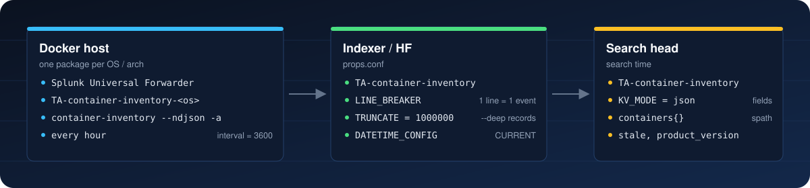

# Splunk Universal Forwarder integration

English | [Tiếng Việt](vi/splunk.md)

<p align="center"></p>

On each run the tool prints **one JSON line per image** (`--ndjson`), stopped containers included (`-a`). Sourcetype: `container:inventory`.

## Packages

Published on [Releases](https://github.com/namdodayne/container-inventory/releases/latest):

| Package | Install on | Contents |
|---|---|---|
| `TA-container-inventory.tgz` | Indexers, heavy forwarders, search heads | `props.conf` (event breaking, JSON fields). No input. |
| `TA-container-inventory-linux-amd64.tgz` | UF on Linux x86_64 | props + `inputs.conf` + binary + `container_inventory.path` |
| `TA-container-inventory-linux-arm64.tgz` | UF on Linux arm64 | same |
| `TA-container-inventory-windows-amd64.tgz` | UF on Windows x64 | same, `.exe` binary |
| `TA-container-inventory-macos-arm64.tgz`, `-macos-amd64.tgz` | UF on macOS | same |

Each target has its own app name. The `.path` file must hold an absolute path to the binary, and that path contains the app name; distinct names also let a deployment server hold every platform side by side.

## 1. Indexers and search heads

```bash
tar -xzf TA-container-inventory.tgz -C $SPLUNK_HOME/etc/apps/
$SPLUNK_HOME/bin/splunk restart
```

Indexer cluster: place it in `manager-apps/` and apply the bundle. Search head cluster: place it in the deployer's `shcluster/apps/`.

To use a dedicated index, create it first (e.g. `container_inventory`) and set `index` in step 3.

## 2. Universal Forwarder

### Linux

```bash
tar -xzf TA-container-inventory-linux-amd64.tgz -C /opt/splunkforwarder/etc/apps/
sudo -u splunkfwd /opt/splunkforwarder/etc/apps/TA-container-inventory-linux-amd64/bin/container-inventory --version
```

**Docker access.** Since 9.1 the UF runs as `splunkfwd` (older versions: `splunk`). That user needs to read the Docker API. Pick one:

| Option | How | Trade-off |
|---|---|---|
| A. `docker` group | `sudo usermod -aG docker splunkfwd`, then restart the UF | Access to `docker.sock` is root-equivalent on the host. Supports `--deep`. |
| B. Read-only socket proxy (recommended) | Run [docker-socket-proxy](https://github.com/Tecnativa/docker-socket-proxy) with `CONTAINERS=1 IMAGES=1 INFO=1`, bound to `127.0.0.1:2375`. Add `DOCKER_HOST=tcp://127.0.0.1:2375` to `$SPLUNK_HOME/etc/splunk-launch.conf`, then restart the UF. | GET only, so no `--deep` (needs exec). `buildx history` is unavailable too, so local-build detection relies on `RepoDigests` and compose labels. |

Proxy for option B:

```bash
docker run -d --name docker-ro-proxy --restart unless-stopped \
  -v /var/run/docker.sock:/var/run/docker.sock:ro \
  -e CONTAINERS=1 -e IMAGES=1 -e INFO=1 -e POST=0 \
  -p 127.0.0.1:2375:2375 tecnativa/docker-socket-proxy:v0.5.0
```

### Windows

Extract `TA-container-inventory-windows-amd64.tgz` into `C:\Program Files\SplunkUniversalForwarder\etc\apps\` and restart the `SplunkForwarder` service. By default the service runs as `LocalSystem`, which can open the Docker named pipe. With a different service account, add it to `docker-users` (Docker Desktop) or grant it access to `\\.\pipe\docker_engine`.

### macOS

As on Linux, but clear the quarantine flag first:

```bash
xattr -dr com.apple.quarantine /Applications/SplunkForwarder/etc/apps/TA-container-inventory-macos-*
```

### Deployment server

Put the forwarder packages in `$SPLUNK_HOME/etc/deployment-apps/` and create one server class per platform with `machineTypesFilter`:

```ini
# serverclass.conf
[serverClass:container_inventory_linux_amd64]
whitelist.0 = *
machineTypesFilter = linux-x86_64
[serverClass:container_inventory_linux_amd64:app:TA-container-inventory-linux-amd64]
restartSplunkd = true

[serverClass:container_inventory_linux_arm64]
whitelist.0 = *
machineTypesFilter = linux-aarch64
[serverClass:container_inventory_linux_arm64:app:TA-container-inventory-linux-arm64]
restartSplunkd = true

[serverClass:container_inventory_windows]
whitelist.0 = *
machineTypesFilter = windows-x64
[serverClass:container_inventory_windows:app:TA-container-inventory-windows-amd64]
restartSplunkd = true
```

Narrow `whitelist.0` to the hosts that run Docker.

## 3. Customising

Create `local/inputs.conf` in the forwarder app. Never edit `default/`, which upgrades overwrite.

```ini
[script://./bin/container_inventory.path]
index = container_inventory
interval = 1800            # seconds, or cron: 0 */6 * * *
```

To change arguments (add `--deep` or `--apps`), edit the single line in `bin/container_inventory.path`. That file is outside `local/`, so reapply the change after each upgrade:

```text
$SPLUNK_HOME/etc/apps/TA-container-inventory-linux-amd64/bin/container-inventory --ndjson -a --deep --apps /etc/container-inventory/apps.toml
```

`--deep` runs `docker exec -u 0` in every container, so it needs option A above and takes minutes per host. Use a long interval, such as 6 to 24 hours.

## 4. Verifying

```spl
index=main sourcetype=container:inventory earliest=-2h
| stats latest(product) as product latest(registry) as registry by host image
```

No data? Check the forwarder log:

```bash
grep -i "container_inventory\|ExecProcessor" /opt/splunkforwarder/var/log/splunk/splunkd.log | tail
```

| Error in splunkd.log | Cause |
|---|---|
| `permission denied ... docker.sock` | The UF user cannot reach Docker, see Docker access. |
| `failed to connect to the docker API` | Docker is not running, or `DOCKER_HOST` is wrong. |
| `GLIBC_2.xx not found` | OS too old (glibc < 2.28); run `inventory.py` with Python instead. |
| `cannot execute ... noexec` | `/tmp` is mounted `noexec`: add `TMPDIR=/opt/splunkforwarder/var/run` to `splunk-launch.conf`. |

## 5. Example searches

Each event is one image; its containers are in the `containers{}` array.

Application versions and where each version came from:

```spl
index=main sourcetype=container:inventory
| dedup host image_id
| table host image registry product product_version version_source
```

Containers running an outdated image (not recreated after a rebuild or pull):

```spl
index=main sourcetype=container:inventory
| dedup host image_id
| spath path=containers{} output=c | mvexpand c
| spath input=c | where stale="true"
| table host name image tag_image_id status
```

Images with no known version (`latest` tag, no label):

```spl
index=main sourcetype=container:inventory
| dedup host image_id
| where tag="latest" AND product_version=""
| stats values(host) as hosts by image
```

## Other agents

Any agent that tails files works (Elastic Agent / Filebeat, Fluent Bit, Wazuh, Vector, ...): run the tool on a schedule with `--ndjson`, write to a file, and let the agent read it.

Write **a new file per run** rather than overwriting one fixed file. The beginning of the output barely changes between runs, so agents that identify files by a checksum of their first bytes (Splunk `monitor`, Filebeat `fingerprint`) would treat a rewritten file as already read and skip it.

```bash
# /etc/cron.d/container-inventory: one file per hour, kept 2 days. In crontab, % must be escaped as \%.
0 * * * * root d=/var/log/container-inventory; mkdir -p $d && /usr/local/bin/container-inventory --ndjson -a > $d/.tmp && mv $d/.tmp $d/inventory-$(date +\%Y\%m\%d\%H).ndjson && find $d -name '*.ndjson' -mtime +2 -delete
```

On Windows, use Task Scheduler with the same command, writing to `C:\ProgramData\container-inventory\inventory-<hour>.ndjson`.

| Agent | File input |
|---|---|
| Filebeat / Elastic Agent | `filestream` input, `paths: [/var/log/container-inventory/*.ndjson]`, `parsers: - ndjson: {target: ""}` |
| Fluent Bit | `[INPUT] Name tail`, `Path /var/log/container-inventory/*.ndjson`, `Parser json` |
| Wazuh | `<localfile><log_format>json</log_format><location>/var/log/container-inventory/*.ndjson</location></localfile>` |
| Splunk UF (instead of the scripted input) | `[monitor:///var/log/container-inventory/*.ndjson]`, `sourcetype = container:inventory` |
